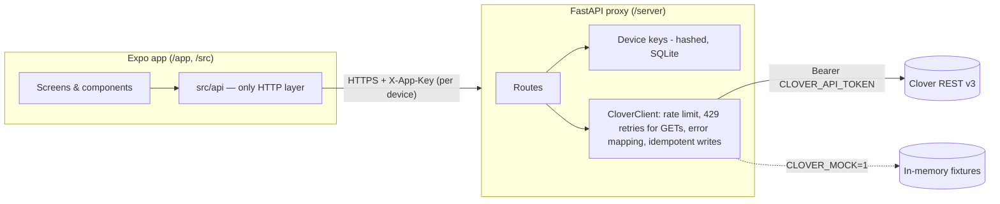

# Stockroom — Clover inventory companion

Mobile inventory app (Expo / React Native) for a two-location grocery that uses **Clover POS as the
system of record**, plus a thin FastAPI proxy that holds the Clover credentials.

> **Status: Milestone 1 (Skeleton).** Tabs, theme, design primitives, proxy with `/health`,
> device pairing, Clover client and mock mode. Catalog, scanning and stock writes arrive in
> Milestones 2–4 (see the build spec). Nothing in this milestone writes stock from the app.

## Architecture



The Clover token and merchant id live **only** in the proxy's environment. The app knows the proxy URL
and its own device key, nothing else.

## Prerequisites

- Node 20+ and npm
- Python 3.12 and [uv](https://docs.astral.sh/uv/) (or plain `pip`)
- Expo Go or a dev build on a device/simulator

## Run the proxy

```bash
cp .env.example server/.env        # CLOVER_MOCK=1 by default: no Clover account needed
cd server
uv sync
uv run uvicorn app.main:app --reload --host 0.0.0.0 --port 8000
curl localhost:8000/health         # {"status":"ok","mock":true,"version":"0.1.0"}
```

Without uv: `python3.12 -m venv .venv && . .venv/bin/activate && pip install fastapi "uvicorn[standard]" httpx pydantic pydantic-settings pytest pytest-asyncio respx`.

### Environment variables (server only)

| Var | Purpose |
|---|---|
| `CLOVER_MOCK` | `1` serves built-in fixtures; `0` calls real Clover |
| `CLOVER_API_TOKEN` | Merchant API token (required when not mocked) |
| `CLOVER_MERCHANT_ID` | Merchant id (required when not mocked) |
| `CLOVER_BASE_URL` | `https://sandbox.dev.clover.com` (sandbox) or `https://api.clover.com` (US prod) |
| `CLOVER_RATE_LIMIT_PER_SEC` / `_BURST` | Token bucket, default 8/s |
| `CLOVER_MAX_GET_ATTEMPTS` | Total tries for GETs on 429 (default 4). Writes are never retried |
| `DATABASE_PATH` | SQLite file for device keys, pairing codes, idempotency, audit |
| `PAIRING_CODE_TTL_SEC`, `PAIRING_MAX_FAILURES_PER_MIN` | Pairing hardening |

## Pair a device

```bash
cd server
uv run python -m app.pair                       # prints e.g. "Pairing code: 1483 4702" (10 min, single use)
uv run python -m app.pair --allow-create-items  # device may create Clover items (Milestone 6)
uv run python -m app.pair --list
uv run python -m app.pair --revoke <device-id>
```

The app redeems the code via `POST /pair {"code","deviceName"}` and gets an `appKey` once; only its
SHA-256 hash is stored. Every later request sends `X-App-Key`. `GET /me` checks a key.
(The in-app pairing screen lands with Settings in a later milestone; `/pair` is usable today.)

## Run the app

```bash
npm install
EXPO_PUBLIC_PROXY_URL=http://<your-LAN-IP>:8000 npx expo start
```

`EXPO_PUBLIC_PROXY_URL` is the only app config and is not a secret. The Settings tab shows proxy
health (and whether it is in mock mode).

## Checks

```bash
npm run typecheck && npm run lint && npm test                       # app
cd server && uv run ruff check . && uv run mypy app tests && uv run pytest   # server
```

## Getting a Clover token

1. Create a Clover **sandbox developer account** at the Clover developer dashboard and a **test merchant**.
2. In the test merchant's dashboard, create an **API token** with **Inventory read + write** and **Merchant read**.
3. Put it in `server/.env` as `CLOVER_API_TOKEN`, set `CLOVER_MOCK=0`.
4. A single-merchant token must stay on the server. Production use across many merchants needs a
   **Clover OAuth app** instead (out of scope for v1).

**Merchant id:** shown in the merchant dashboard URL/account settings (13-char id) — set `CLOVER_MERCHANT_ID`.

**Track stock:** items must have stock tracking enabled in Clover Inventory ("Track stock" — VERIFY exact
setting name) or stock quantities will come back empty.

## Performance notes (10k+ items)

Planned for Milestone 2: list/search screens read only from on-device SQLite (FTS5 for search,
FlashList for rendering); the network only refreshes SQLite via full + delta sync (`modifiedSince`).
That is why scrolling and search do not depend on connectivity or Clover latency.

## Future modules (seams)

- **Purchase orders / suppliers:** new `/src/features/purchasing` plus `/locations/{loc}/purchase-orders` routes;
  receiving reuses the stock write protocol.
- **Cost / margin reporting:** `cost_cents` is carried in the item model; a `/features/finance` module reads it.
- **CSV/PDF exports:** proxy endpoints over the audit log; app only triggers and shares.
- **Multi-location UI:** routes are already `/locations/{locationId}/...`; add entries to `Settings.location()`.
- **User accounts:** device keys already carry identity and a role flag; accounts would map onto them.
- **Clover OAuth:** replaces the static token in `LocationConfig`; the client is otherwise unchanged.
